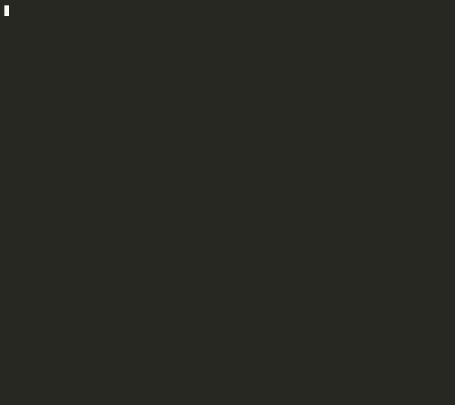

# modelhog

**Your laptop has 100 GB of AI models you forgot about.** modelhog finds every model you ever pulled from Hugging Face, Ollama or LM Studio, plus the developer caches piling up behind them. It shows how big each one is and when you last touched it, and deletes the ones you pick.

```bash
uvx modelhog
```

<p align="center"></p>

<sub>Demo on a made-up home folder (sparse files, so it took no real space) generated by <a href="docs/demo.py">docs/demo.py</a>.</sub>

Everything modelhog lists can be downloaded again. It never touches your code, your documents, or anything it can't name.

## What it finds

| | Where |
|---|---|
| **Hugging Face** | `~/.cache/huggingface/hub` (or `$HF_HOME`, `$HF_HUB_CACHE`): one line per model and dataset |
| **Ollama** | `~/.ollama/models` (or `$OLLAMA_MODELS`): one line per `model:tag`, sizes from the manifests, shared layers counted once |
| **LM Studio, llama.cpp, GPT4All, Jan** | their model folders |
| **Whisper, PyTorch Hub, Keras, CLIP** | their download caches |
| **Dev caches** | pip, uv, npm, Yarn, pnpm, Bun, Cargo, Go modules, Gradle, Maven, Homebrew, Playwright, Puppeteer, conda, CocoaPods, pre-commit, Hugging Face datasets |
| **Apple** | Xcode DerivedData and archives, iOS simulators |
| **Docker** | Docker Desktop's disk image (what's actually used, not the sparse maximum) |
| **Project junk** (`--projects`) | `node_modules`, `.venv`, `target`, `.next`, `.turbo`, `Pods`, `.tox`… inside folders that are real projects |

"Last used" is the newest modification time inside each folder, which is when you last downloaded or changed it. Operating systems don't reliably record when a file was last read.

## Cleaning up

```bash
modelhog clean 1 3 7                     # numbers from the list
modelhog clean --older-than 90d          # everything untouched for 90 days (also 12w, 6m, 1y)
modelhog clean --older-than 6m --only ai # just the models
modelhog clean 2 --dry-run               # show what would go
```

It always lists what it's about to delete and the total, then asks before deleting (`--yes` to skip the prompt).

A few things are removed with their own tool rather than by deleting files, because deleting files would break them:

- **Ollama** models share layers, so modelhog runs `ollama rm model:tag`.
- **Docker** gets `docker system prune -a --volumes`.
- **iOS simulators** get `xcrun simctl delete unavailable`.
- **Go modules** get `go clean -modcache`.

## Options

```
modelhog                      # AI models and dev caches
modelhog --projects ~/code    # also project junk under ~/code
modelhog --only ai            # or caches, projects
modelhog --all                # list everything, not just the biggest 40
modelhog --json               # for scripts
```

## Install

```bash
uvx modelhog           # run without installing
pipx install modelhog  # or install it
```

Requires Python 3.9+. The only dependency is `rich`. macOS, Linux and Windows.

## License

MIT
